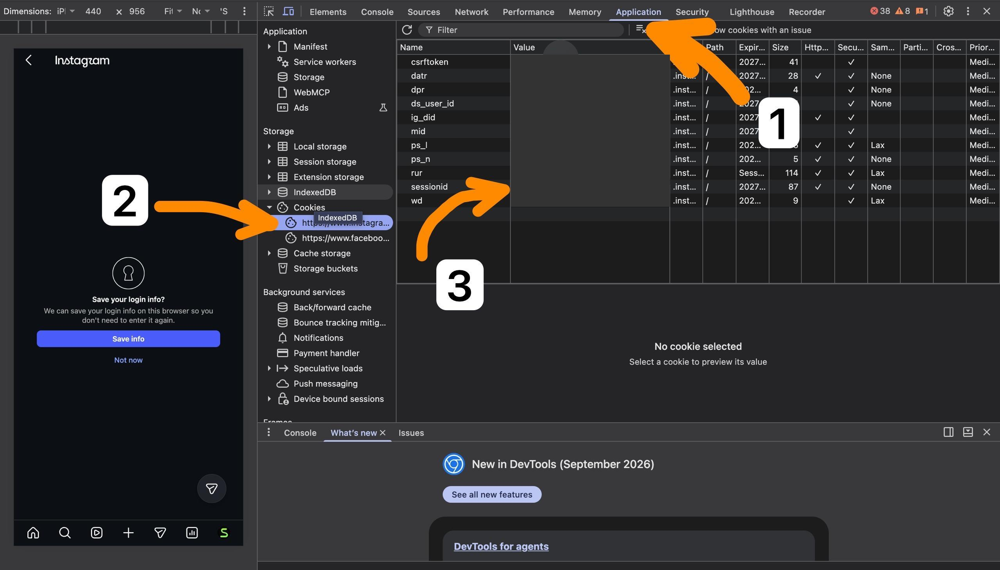
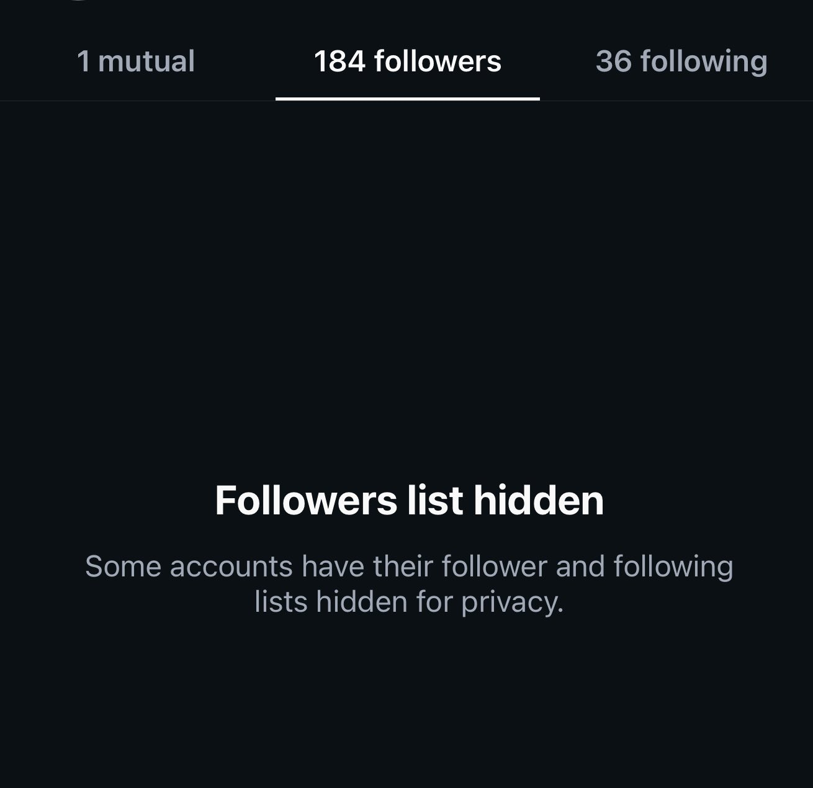

# Hide Follower & Following Lists

A Python script that asks Instagram to enable the hidden follower/following lists setting on your account.

## How to use

1. Log in to **your own account** at [instagram.com](https://www.instagram.com/) in Chrome on a computer.
2. Open Developer Tools (`F12` or `Cmd+Option+I` on Mac). Go to **Application → Cookies → instagram.com**, then find the `sessionid` row and copy its **Value**.

   

3. Install Python 3 if needed, then run this from the project folder (no extra packages required):

   ```bash
   python3 hide_lists.py
   ```

   To show the lists again, add `--unhide`:

   ```bash
   python3 hide_lists.py --unhide
   ```

4. Paste **only the cookie value** when prompted (not `sessionid=`). Your input will not appear on screen. If Instagram confirms the change, the script prints `Enabled: Instagram returned value=true. Lists are hidden.` (or `Disabled: Instagram returned value=false. Lists are visible again.` with `--unhide`).
5. Check your account from another account to see whether the lists are hidden. Example result:

   

**Keep your `sessionid` private.** It grants access to your account. Never share it or post a screenshot showing its value. The script sends it to Instagram to make the request but does not save it to a file.

**Note:** This uses an unofficial Instagram endpoint. It may not work for every account or may stop working. A success message means Instagram confirmed the setting, not that every viewer will see the same result. If a request times out, check your account before running it again.
